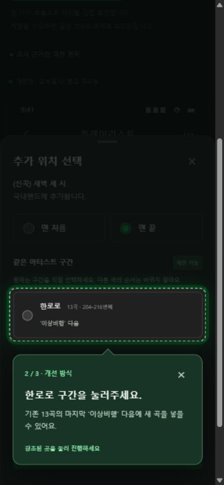

# 멜론 플레이리스트 UX 개선 프로토타입

약 10년간 멜론을 이용한 경험에서 출발해, 수백 곡을 직접 정리하는 사용자의 플레이리스트 관리 부담을 줄이는 개선안을 탐색합니다.

**핵심 제안:** 사용자가 만든 곡 순서를 유지하면서 새 곡을 같은 아티스트 구간에 담고, 아티스트 블록 전체와 블록 내부의 곡을 각각 편집합니다.

## 체험 흐름

처음 방문하면 코치마크가 곡 추가 버튼을 강조합니다. 안내된 실제 요소를 눌러 다음 순서로 진행합니다. 재실행은 **‘처음부터 체험하기’** 하나로 통일했습니다.

1. **기본 방식:** 한로로의 가상 신곡을 맨 끝에 담고 기존 아티스트 구간과 떨어지는 결과를 확인합니다.
2. **개선 방식:** 동일한 원본 목록에서 한로로 구간을 선택해 담고, 두 결과의 위치를 비교합니다.
3. **블록 편집:** 아티스트 블록을 통째로 옮긴 뒤 내부 곡 순서를 바꾸고 저장합니다.

× 또는 Escape로 안내를 닫으면 개선안을 자유롭게 조작할 수 있습니다. 체험 완료·닫기 여부만 브라우저에 기록하며, 곡 목록 변경은 새로고침하면 초기화됩니다.

## 현재 데모

모바일 음악서랍의 공개 UI 자료를 참고해 저장한 플레이리스트 상세·편집 화면을 재구성했습니다. 공식 앱의 최신 화면을 직접 조작한 완전 재현은 아닙니다. 확인한 기존 요소와 제안 기능의 경계는 조사 문서에 기록했습니다.

- ‘처음부터 체험하기’ 하나로 진입합니다. 같은 224곡에서 기본 방식 → 개선 방식 → 블록 편집으로 이어지는 코치마크를 제공합니다.
- 화면을 어둡게 덮고 실제 눌러야 할 버튼·추가 위치만 강조합니다. 액션을 수행하면 다음 단계로 진행하며, 결과 확인에는 ‘다음’을 사용합니다.
- 기본 목록은 원래 곡 순서를 그대로 표시하며 분리된 아티스트 구간을 오류로 판정하지 않습니다.
- 가상 신곡을 맨 처음·맨 끝에 추가하거나, 개선안에서 동일 아티스트의 기존 구간을 직접 선택합니다.
- 삽입 위치의 앞뒤 곡 미리보기와 최근 변경 1회 되돌리기.
- 편집 중 임시 목록을 관리하고 완료·취소로 저장 여부를 결정합니다.
- 개별 곡 드래그 및 위/아래 이동, 다중 선택·삭제.
- 개선안 편집은 아티스트 블록이 기본입니다. 블록 전체 이동과 블록 내부의 곡 순서 조정을 별도로 지원합니다. 분산된 구간을 강제로 합치지 않습니다.
- 아티스트 가나다순은 보기만 변경합니다. 편집에 들어가면 저장된 순서로 복귀합니다.
- 곡명·아티스트 검색, 음악서랍 진입, 별도 재생 대기열과 미니플레이어 상태 미리보기.
- 실제 음원·서버 저장 없이 더미 데이터로 동작합니다. 실제 앨범아트 대신 로컬 이니셜 SVG를 사용합니다.

## 조사와 기획

- [현행 모바일 기능 조사와 재현 범위](docs/멜론_모바일_현행조사.md)
- [블록 편집과 코치마크 체험 흐름](docs/블록_편집_및_체험가이드.md)
- [포트폴리오 발전계획](docs/포트폴리오_발전계획.md)
- [사용자 조사·서비스 확인 기록지](docs/사용자_조사_및_서비스_확인.md)
- [초기 MVP 기획서](docs/멜론_플레이리스트_개선_기획서.md)

공식 스토어·버전 기록·공개 홍보 화면을 조사했습니다. 외부 불편 사례는 공개 리뷰 한 건이며 시장 수요를 증명하지 않습니다. 현재 모바일의 아티스트 정렬·다중 이동 지원 범위와 상세 UI는 실제 기기 확인이 필요합니다. 사용자 인터뷰·효과 측정·배포는 아직 완료하지 않았습니다.

## 실행과 검증

Node.js와 npm이 설치된 환경에서:

    npm install
    npm run dev

운영 빌드와 미리보기:

    npm run build
    npm run preview

검증:

    npm test
    npm run lint

기존 13개와 신규 6개, 총 19개의 로직 테스트가 있습니다. 신규 검증은 원본 순서 보존, 분산 구간 후보, 선택 구간 삽입, 중복 방지, 블록·곡 이동을 다룹니다. 동작을 수치로 비교할 때는 현행 앱의 실제 동작을 먼저 확보해야 합니다.

브라우저에서는 코치마크 전체 흐름, 기본 225번째/개선 217번째 삽입 결과, 블록 전체·내부 이동, 저장, 모바일 배치, Tab 이동 범위와 Escape 종료·재실행을 확인했습니다. 이 위치 비교는 데모의 예시이며 실제 멜론과의 사용성 측정 결과는 아닙니다.

## 기술과 주요 파일

React 19, Vite, dnd-kit. 프론트 상태로만 동작하며 실제 음원 API나 인증을 사용하지 않습니다.

- src/App.jsx: 모바일 데모 진입점
- src/components/MelonMobileDemo.jsx: 모바일 목록·편집·삽입 위치·재생 상태 시연
- src/components/Sheet.jsx: 포커스와 Escape를 지원하는 네이티브 dialog
- src/components/CoachMark.jsx: 실제 액션 대상 강조, 바텀시트 레이어 대응, 키보드 이동 범위 제한
- src/MobileApp.css: 모바일 UI 및 포트폴리오 체험 레이아웃
- src/utils/playlistEditing.js: 표시 정렬·모든 삽입 후보·사용자 선택 이동 로직
- src/data/dummyTracks.js: 국내밴드 224곡 기반 데이터. 추가 날짜는 임의 값
- src/data/newTrackCandidates.js: 실제 발매 정보가 아닌 가상 신곡

이전 App.css, PlaylistView, analyzeBlocks 등은 초기 MVP 구현 기록으로 남아 있으며 현재 데모의 진입점에서 사용하지 않습니다.
